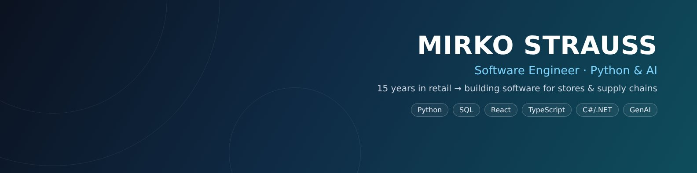

<p align="center">
  
</p>

<p align="center">
  <a href="https://github.com/Mirko-Strauss">
    
  </a>
</p>

<p align="center">
  <a href="https://www.linkedin.com/in/mirko-strauss-dev"></a>
  <a href="https://mirko-strauss.github.io"></a>
  
</p>

---

### About me

```python
class MirkoStrauss:
    location   = "Baden-Württemberg, Germany"
    role       = "Junior Software Engineer · WBS Coding School (2026–2027)"
    background = "15 years leading a fresh-produce department in retail"
    focus      = ["Python", "Backend & APIs", "Generative AI", "Retail tech"]
    looking_for = "Internship (Jul–Aug 2027) & junior roles – remote or hybrid"

    def why_me(self):
        return "I know the problems in stores first-hand – now I write the code that solves them."
```

### Tech stack

**Working with**

<p>
  
  
  
  
  
  
  
</p>

**Currently learning**

<p>
  
  
  
  
  
</p>

### Roadmap

- [x] Built a solid Python foundation through self-study – books and video tutorials
- [x] Designed and built my first website
- [x] Built **J.A.R.V.I.S.**, an AI voice assistant with Flask and Gemini function calling – [view project](https://github.com/mirko-strauss/jarvis-voice-assistant)
- [ ] Software Engineering & AI program – WBS Coding School *(in progress, until Sep 2027)*
- [ ] Certifications: PCEP (Python) · AZ-900 (Azure)
- [ ] Internship in software development – July/August 2027

### GitHub activity

<p align="center">
  
</p>
